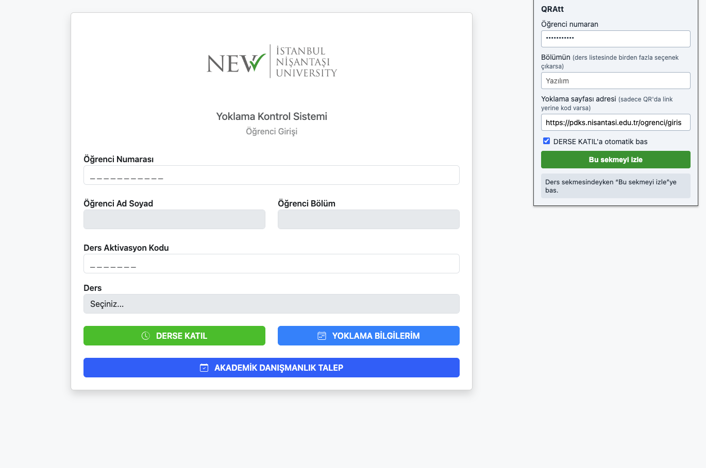

# QRAtt

QRAtt, canlı ders sekmesini arka planda izleyen bir Chrome eklentisidir. Ekranda yoklama QR kodu belirdiğinde kodu okur, yoklama sayfasını açar, öğrenci numaranı yazar ve **DERSE KATIL**'a basar. Sonucu sana bildirim olarak gösterir.



## Özellikler

- Seçtiğin sekmeyi, sekme arka plandayken bile 2 saniyede bir tarar.
- QR'daki linki açar; link yerine yalnızca kod varsa ayarladığın yoklama sayfasını kullanır.
- Öğrenci numarasını ve aktivasyon kodunu doldurur, ders listesinden bölümüne uyan seçeneği seçer.
- İstersen formu yalnızca doldurur, butona basmayı sana bırakır.
- Başarılı bir katılımdan sonra 5 dakika bekler ve aynı QR'ı iki kez işlemez.
- Kısayol: `Alt+Shift+Q` açık sekmeyi izlemeye başlatır.

## Kurulum

1. Repoyu indir veya klonla:
   ```bash
   git clone https://github.com/SemihSamandar/QRAtt.git
   ```
2. Chrome'da `chrome://extensions` adresini aç.
3. Sağ üstten **Geliştirici modu**'nu aç.
4. **Paketlenmemiş öğe yükle**'ye tıkla ve `QRAtt` klasörünü seç.

## Kullanım

1. Eklenti simgesine tıkla ve **öğrenci numaranı** yaz.
2. Gerekirse diğer alanları doldur:
   - **Bölümün** — ders listesinde birden fazla seçenek çıkıyorsa (ör. `Yazılım`).
   - **Yoklama sayfası adresi** — QR'da link değil yalnızca kod varsa.
   - **DERSE KATIL'a otomatik bas** — kapatırsan form doldurulur, butona sen basarsın.
3. Ders sekmesindeyken **Bu sekmeyi izle**'ye bas. Simgede yeşil `ON` rozeti görünür.
4. Sekmeyi arka plana alabilirsin ama **kapatma**. Sekme kapanınca izleme durur.
5. Bitirince **İzlemeyi durdur**'a bas.

## Nasıl çalışır

| Dosya | Görevi |
| --- | --- |
| `background.js` | Service worker. İzleme durumunu tutar, QR içeriğini işler, yoklama sekmesini açıp formu doldurur. |
| `offscreen.js` | Görünmez belge. `tabCapture` ile sekme görüntüsünü alır ve [jsQR](https://github.com/cozmo/jsQR) ile QR arar. |
| `popup.html` / `popup.js` | Ayarlar ve izlemeyi başlat/durdur arayüzü. |
| `manifest.json` | Manifest V3 tanımı, izinler ve kısayol. |

Form alanları etiket metinlerine göre bulunur (`Öğrenci Numarası`, `Ad Soyad`, `Ders Aktivasyon Kodu`, `Ders`). Yoklama sayfası farklı etiketler kullanıyorsa `background.js` içindeki `fillForm` fonksiyonunu uyarlaman gerekir.

## Yerel test

`test/` klasöründe gerçek sisteme hiçbir şey göndermeyen iki sayfa var: canlı dersi taklit eden `ders.html` ve yoklama formunu taklit eden `yoklama.html`.

```bash
python3 -m http.server 8765 --directory test
```

1. `http://localhost:8765/ders.html` adresini aç ve sekmeyi eklentiyle izlemeye al.
2. **QR göster**'e bas. Eklenti yoklama sayfasını açıp formu doldurmalı, katılım listede görünmeli.

## İzinler

| İzin | Neden |
| --- | --- |
| `tabCapture`, `offscreen` | Seçilen sekmenin görüntüsünü okuyup QR aramak |
| `tabs`, `scripting`, `<all_urls>` | Yoklama sayfasını açmak ve formu doldurmak |
| `storage` | Ayarları ve izleme durumunu saklamak |
| `notifications` | Sonucu bildirmek |

Ayarlar yalnızca Chrome'un kendi depolamasında (`chrome.storage.sync`) tutulur. Eklenti hiçbir sunucuya veri göndermez; ekran görüntüleri kaydedilmez, yalnızca bellekte taranır.

## Uyarı

Bu eklenti kişisel kullanım için yazılmıştır. Kullanmadan önce okulunun yoklama kurallarını kontrol et; derste bulunmadan yoklamaya katılmak kurallara aykırı olabilir.

## Teşekkür

QR okuma için [jsQR](https://github.com/cozmo/jsQR) (Apache 2.0) kullanılır.
